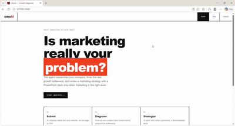

# cmoAI — AI Business Consultant

**Diagnose the real business problem before prescribing a marketing solution.**

cmoAI is an AI-powered business consulting system that analyzes a company's available information, researches its market and competitors, identifies its primary growth bottleneck, and determines whether marketing is actually the right solution.

When marketing is the appropriate lever, cmoAI generates an evidence-based marketing strategy and a consulting PowerPoint presentation. When it isn't, the system reports the actual business issue instead of forcing a marketing recommendation.

Built as a **modular monolith**, V1 keeps business decision-making centralized in one Orchestrator, with dedicated services for data collection, processing, research, and report generation.

---

## Demo

<div align="center">



</div>

---

## The Problem

Businesses often approach marketing as the default solution to declining growth.

But what if marketing isn't the actual problem?

- A company may have enough traffic but a poor conversion rate.
- Its product positioning may not match the market.
- Pricing or customer retention may be the real bottleneck.
- Marketing investment may increase costs without solving the underlying issue.

**cmoAI approaches business consulting differently.**

Instead of immediately generating marketing ideas, it first investigates the business, gathers evidence, and diagnoses the primary growth bottleneck.

The goal is simple: **recommend the right business action, not just generate another marketing strategy.**

---

## How It Works

The system follows an end-to-end consulting pipeline:

```text
Company Information
        │
        ▼
Data Collection
        │
        ▼
Market & Competitor Research
        │
        ▼
Business Information Extraction
        │
        ▼
Business Diagnosis
        │
        ▼
Is Marketing the Primary Issue?
        │
        ├── YES ──► Generate Marketing Strategy
        │                    │
        │                    ▼
        │             Consulting Report
        │                    │
        │                    ▼
        │              PowerPoint
        │
        └── NO ───► Diagnosis Report
                             │
                             ▼
                      PowerPoint
```

### 1. Company Data Collection

Collects information from multiple sources:

- Company website and relevant internal pages.
- PDF documents and company reports.
- LinkedIn profiles.
- Facebook pages.
- Instagram profiles.
- Additional URLs provided by the user.

Website content is extracted through web scraping, while social media collection can use Agent-Reach integrations with a metadata-based fallback.

### 2. Market & Competitor Research

Uses a lightweight LLM service to research the company's industry, market trends, and competitors.

### 3. Business Information Extraction

Transforms collected content into structured business information, including:

- Company description.
- Products and services.
- Pricing information.
- Target customers.
- Business model.
- Relevant operational and commercial details.

### 4. Business Diagnosis

The Orchestrator evaluates the collected information and research to identify the company's primary growth bottleneck.

It determines whether marketing is genuinely the primary issue and supports the diagnosis with findings and evidence.

### 5. Marketing Strategy Generation

When marketing is recommended, cmoAI generates an actionable strategy based on the diagnosis and available evidence.

Users can also explicitly request a marketing strategy when the diagnosis concludes that marketing is not the primary issue. In that case, the generated strategy includes an override disclaimer.

### 6. Consulting Report & PowerPoint

The system generates a structured consulting report and exports a PowerPoint presentation containing the diagnosis and, when applicable, the marketing strategy.

---

## Architecture

cmoAI V1 follows a **modular monolith architecture**.

The system separates responsibilities into independent packages while keeping deployment and orchestration straightforward.

| Component | Responsibility |
|---|---|
| `api/` | FastAPI endpoints and end-to-end pipeline wiring |
| `orchestrator/` | Business diagnosis, decisions, strategy, and report generation |
| `services/` | Data collection, research, extraction, and PowerPoint generation |
| `domain/` | Shared Pydantic models and business entities |
| `storage/` | SQLite database schema and repository layer |
| `config/` | Application settings and logging |
| `static/` | Frontend interface |
| `tests/` | Automated tests |

### Architectural Principles

- **Single decision-maker:** The Orchestrator owns business reasoning and decisions.
- **Separation of concerns:** Services collect, transform, or render information without making business decisions.
- **Structured data:** Information is represented using shared domain models.
- **Persistence:** SQLite stores consulting cases, collected sources, research, diagnoses, strategies, and reports.
- **Evidence-based recommendations:** Business decisions should be supported by available findings.
- **Explicit failure handling:** Failed pipeline steps are recorded against the consulting case.
- **Modularity:** Components can evolve independently without introducing unnecessary architectural complexity.

---

## Project Structure

```text
cmo-ai/
│
├── api/
│   ├── __init__.py
│   ├── consulting_pipeline.py
│   ├── main.py
│   └── schemas.py
│
├── config/
│   ├── __init__.py
│   ├── settings.py
│   └── logging_config.py
│
├── domain/
│   ├── __init__.py
│   ├── business_diagnosis.py
│   ├── collected_source.py
│   ├── company_profile.py
│   ├── consulting_case.py
│   ├── enums.py
│   ├── extracted_company_information.py
│   ├── finding.py
│   ├── generated_report.py
│   ├── market_research.py
│   └── marketing_strategy.py
│
├── orchestrator/
│   ├── __init__.py
│   ├── business_diagnosis_generator.py
│   ├── context_builders.py
│   ├── errors.py
│   ├── main_llm_client.py
│   ├── marketing_strategy_generator.py
│   └── report_generator.py
│
├── services/
│   ├── __init__.py
│   ├── agent_reach_client.py
│   ├── information_extraction_service.py
│   ├── market_research_service.py
│   ├── pdf_collector_service.py
│   ├── powerpoint_generator_service.py
│   ├── small_llm_client.py
│   ├── social_media_collector_service.py
│   └── website_collector_service.py
│
├── storage/
│   ├── __init__.py
│   ├── business_diagnosis_repository.py
│   ├── collected_source_repository.py
│   ├── company_profile_repository.py
│   ├── consulting_case_repository.py
│   ├── database_connection.py
│   ├── extracted_company_information_repository.py
│   ├── generated_report_repository.py
│   ├── id_generator.py
│   ├── json_codec.py
│   ├── market_research_repository.py
│   ├── marketing_strategy_repository.py
│   └── schema.py
│
├── static/
│   └── index.html
│
├── tests/
│   ├── fixtures/
│   └── test_*.py
│
├── data/
│   └── generated_reports/
│
├── logs/
│
├── main.py
├── requirements.txt
└── .gitignore
```

---

## Tech Stack

| Category | Technologies |
|---|---|
| Language | Python |
| Backend API | FastAPI, Uvicorn |
| Frontend | HTML, CSS, JavaScript |
| Data Validation | Pydantic, Pydantic Settings |
| LLM Providers | Google Gemini, NVIDIA Nemotron |
| Data Collection | Requests, HTTPX, BeautifulSoup, lxml |
| Social Media Integration | Agent-Reach, OpenCLI |
| PDF Processing | pypdf |
| Presentation Generation | python-pptx |
| Database | SQLite |
| Testing | Pytest, pytest-mock |
| Logging | Python Logging, RotatingFileHandler |

### LLM Configuration

The application supports configurable LLM providers:

- **Main LLM:** Used by the Orchestrator for diagnosis, strategy generation, and report generation.
- **Small LLM:** Used by the market research and information extraction services.

The providers and model names are configurable through environment settings.

---

## Installation & Setup

### Requirements

- Python 3.10+
- pip
- A Gemini or NVIDIA API key, depending on the configured providers.

### 1. Clone the Repository

```bash
git clone <your-repository-url>
cd cmo-ai
```

### 2. Create a Virtual Environment

```bash
python -m venv venv
```

Activate it:

**Linux / WSL:**

```bash
source venv/bin/activate
```

**Windows:**

```bash
venv\Scripts\activate
```

### 3. Install Dependencies

```bash
pip install -r requirements.txt
```

### 4. Configure Environment Variables

Create a `.env` file in the project root.

Example configuration:

```env
# Main reasoning model
MAIN_LLM_PROVIDER=gemini
GEMINI_API_KEY=your_gemini_api_key
GEMINI_MODEL=gemini-2.0-flash

# Small LLM services
SMALL_LLM_PROVIDER=gemini
SMALL_LLM_MODEL=gemini-2.0-flash-lite

# NVIDIA provider (if selected)
NVIDIA_API_KEY=your_nvidia_api_key
NEMOTRON_MODEL=nvidia/nemotron-4-340b-instruct

# Application
APP_ENV=development
LOG_LEVEL=INFO

# Database
SQLITE_DB_PATH=./data/cmoai.db

# API
API_HOST=127.0.0.1
API_PORT=8000
```

The application also supports additional settings for collectors, logging, research, and PowerPoint output. See `config/settings.py` for the complete configuration.

**Important:** Never commit your `.env` file or expose API keys.

---

## Running the Application

Start the FastAPI application:

```bash
uvicorn api.main:app --reload
```

Open the application:

- **Frontend:** http://127.0.0.1:8000/
- **Swagger UI:** http://127.0.0.1:8000/docs
- **Health Check:** http://127.0.0.1:8000/health

The frontend is served directly by FastAPI from `static/index.html`.

---

## API Reference

### Main Endpoints

| Method | Endpoint | Description |
|---|---|---|
| `GET` | `/health` | Check API availability |
| `POST` | `/consulting-cases` | Create a case and run the full consulting pipeline |
| `GET` | `/consulting-cases` | List all consulting cases |
| `GET` | `/consulting-cases/{case_id}` | Retrieve a specific case |
| `GET` | `/consulting-cases/{case_id}/report` | Retrieve the generated report |
| `POST` | `/consulting-cases/{case_id}/generate-strategy-anyway` | Override the diagnosis and generate a strategy |
| `GET` | `/consulting-cases/{case_id}/download-pptx` | Download the PowerPoint presentation |

### Example: Create a Consulting Case

```bash
curl -X POST http://127.0.0.1:8000/consulting-cases \
  -H "Content-Type: application/json" \
  -d '{
    "company_name": "Acme Corp",
    "website_url": "https://acme.example.com",
    "linkedin_url": "https://linkedin.com/company/acme",
    "additional_links": [
      "https://acme.example.com/about"
    ]
  }'
```

The request supports:

- `company_name` — Required.
- `website_url` — Optional.
- `pdf_file_path` — Optional server-accessible PDF path.
- `linkedin_url` — Optional.
- `facebook_url` — Optional.
- `instagram_url` — Optional.
- `additional_links` — Optional list of URLs.

**Note:** V1 accepts a server-side PDF path rather than providing an HTTP file-upload endpoint.

### Retrieve a Case

```bash
curl http://127.0.0.1:8000/consulting-cases/{case_id}
```

### Retrieve Its Report

```bash
curl http://127.0.0.1:8000/consulting-cases/{case_id}/report
```

### Download the PowerPoint

```bash
curl -OJ http://127.0.0.1:8000/consulting-cases/{case_id}/download-pptx
```

### Generate a Strategy Anyway

```bash
curl -X POST \
  http://127.0.0.1:8000/consulting-cases/{case_id}/generate-strategy-anyway
```

---

## Error Handling

The API provides structured HTTP error responses:

| Error | HTTP Status | Meaning |
|---|---:|---|
| Invalid consulting request | `400` | The pipeline cannot proceed with the provided input |
| Orchestrator failure | `502` | An AI reasoning or generation step failed |
| Missing case or report | `404` | The requested resource does not exist |
| Unexpected application error | `500` | An unexpected server-side failure occurred |

Failed pipeline executions update the consulting case status and record the failure reason.

---

## Running Tests

Run the complete test suite:

```bash
pytest tests/ -v
```

The test suite covers:

- Domain models and validation.
- SQLite repositories and persistence.
- Website, PDF, and social media collectors.
- Market research and information extraction.
- LLM clients and provider error handling.
- Business diagnosis and strategy generation.
- Report and PowerPoint generation.
- Consulting pipeline orchestration.
- FastAPI endpoints and error handling.

Tests use isolated database fixtures and mocked external interactions where appropriate.

---

## V1 Design Decisions

V1 deliberately avoids unnecessary infrastructure.

| Decision | Reason |
|---|---|
| Modular monolith | Keep deployment and maintenance straightforward |
| One Orchestrator | Centralize business decisions |
| SQLite | Simple, persistent storage for V1 |
| No vector database | Not required by the current workflow |
| No knowledge graph | Avoid unnecessary complexity |
| No multi-agent framework | Keep reasoning and control flow explicit |
| No task queue | Keep the initial execution flow synchronous |

### Important Execution Detail

The full consulting pipeline runs synchronously in V1.

A `POST /consulting-cases` request returns after the collection, research, extraction, diagnosis, and report-generation pipeline finishes. Web scraping and multiple LLM calls can make the request take a minute or two.

There is no background task queue in the current implementation.

---

## Future Direction

V1 establishes the core consulting workflow and its architectural boundaries.

Future improvements can build on this foundation without prematurely complicating the current system.

Potential areas of evolution include:

- Background execution for long-running consulting cases.
- More advanced business data integrations.
- Expanded research and evidence collection.
- Improved report customization.
- Additional business analysis capabilities.
- More sophisticated persistence and retrieval when justified by actual requirements.

---

## Core Philosophy

**Don't prescribe marketing before understanding the business.**

cmoAI is built around a simple principle:

A good business consultant doesn't start with a solution. They start by understanding the problem.

